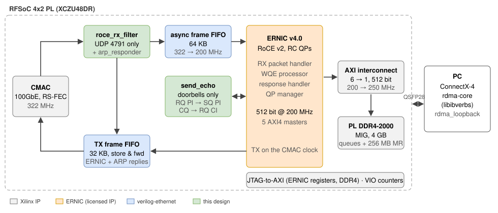

-9A90FD.svg) -orange.svg)   

[English](#en) | [中文](#cn)

　

<span id="en">RFSoC 4x2 100G RDMA with ERNIC</span>
===========================

RoCE v2 on the RFSoC 4x2 (XCZU48DR-FFVG1517-2-E) QSFP28 port with the AMD ERNIC v4.0 IP, PL only. A Linux host with a Mellanox ConnectX-4 connects an RC queue pair to the FPGA and RDMA WRITEs into, and RDMA READs from, a memory region in the PL DDR4: **256 MB WRITE at 97.98 Gbit/s and READ at 98.02 Gbit/s, byte-exact, the RDMA line rate of 100GbE at a 4096-byte path MTU.**

Phase 1 of three: memory loopback (this release, `v0.1-memory-loopback`); next a hardware message echo (host SEND → FPGA → SEND back) and then an RF data path.

　

|  |
| :--------------------------------: |
| **Figure1** : data path            |

　

## Technical Features

* **ERNIC v4.0** at 512 bit × 200 MHz with 8 queue pairs; the CMAC side at 322 MHz. RoCE v2 frames (UDP 4791) are filtered from the CMAC receive stream and cross to ERNIC's clock through an asynchronous frame FIFO; ERNIC transmits on the CMAC clock through a store-and-forward frame FIFO.
* **PL DDR4** (MIG, 4 GB, 512 bit × 250 MHz) behind a 6 → 1 AXI interconnect holds the queues, doorbells, error buffers and a 256 MB memory region (R_Key 0x12, VA 0x1000_0000).
* **ARP responder** in the fabric: the host resolves the ERNIC address like any other neighbour.
* **No processor**: ERNIC registers and DDR4 are programmed over JTAG (JTAG-to-AXI); the host QP is connected by hand (no connection manager) with `tests/ernic_config.tcl`, which also dumps ERNIC's counters and its error buffer.

　

## Performance Test Results

Host: Core Ultra 7 265K, Mellanox ConnectX-4 (PCIe 3.0 x16), Ubuntu 24.04, rdma-core 50, IOMMU on. `host/rdma_loopback`: one RC QP, 1 MB RDMA operations, 32 in flight, 256 MB per direction, data compared word by word after every READ.

| Run | RDMA WRITE (host → FPGA DDR4) | RDMA READ (FPGA DDR4 → host) | Compare |
| :-: | :---------------------------: | :--------------------------: | :-----: |
| 1 | 97.96 Gbit/s | 98.02 Gbit/s | identical |
| 2 | 97.99 Gbit/s | 98.01 Gbit/s | identical |
| 3 | 97.97 Gbit/s | 98.02 Gbit/s | identical |
| 4 | 97.97 Gbit/s | 98.02 Gbit/s | identical |
| 5 | 98.00 Gbit/s | 98.02 Gbit/s | identical |

With a 4096-byte path MTU every packet carries 82 bytes of Ethernet/IPv4/UDP/BTH/ICRC/FCS headers, preamble and gap, so the RDMA payload limit of 100GbE is 4096 / 4178 = **98.04 Gbit/s**; measured 97.96–98.02 Gbit/s. No packet was dropped by the host NIC, no retransmission. Raw data: [docs/results](./docs/results).

Timing met: WNS +0.204 ns, WHS +0.010 ns. Resources: 69,315 LUT (16.3 %), 96,400 FF, 248.5 BRAM, 20 URAM.

　

## ERNIC v4.0 Integration Notes

Found on hardware; each one alone keeps every packet from being accepted.

| | |
| :-- | :-- |
| RX clock | `roce_cmac_s_axis` is sampled on ERNIC's AXI clock (200 MHz), not on `cmac_rx_clk`: the CMAC stream needs an asynchronous FIFO (here store-and-forward, so frames reach ERNIC without gaps; 512 bit × 200 MHz drains faster than 100G). |
| RX `tuser` | `roce_cmac_s_axis_tuser` = 1 on the last beat means the frame is good (the example design drives it with `tlast`); 0 gives FCS errors on every packet. |
| QP registers | QP *i* is at `0x18_0000 + i × 0x100` (QP1 at `0x18_0100`, QP2 at `0x18_0200`). |
| Enabled QPs | `XRNIC_CONF_QP_EN` (`0x10_0044`) = highest QP number (7 for 8 QPs), written before the QPs are configured; `XRNICCONF[23:8]` is the UDP source port. |
| Addresses | MAC: `MSB` register = bytes 0–1, `LSB` = bytes 2–5 (`02:00:00:00:00:01` → `0x0200`, `0x00000001`); IPv4 as a number (`192.168.100.1` → `0xC0A86401`); R_Key = MR index << 8 \| 8-bit key. |
| Debug | Rejected packets go to the error buffer in DDR (syndrome word + header) although `ERRBUFWPTR` stays 0; counters at `0x10_0100`–`0x10_0138` (`0x118` invalid, `0x130` dropped). |
| Host READ path | With the IOMMU on, READ responses at line rate into 4 KB pages were dropped by the host NIC (`rx_discards_phy`, READ 26–76 Gbit/s with retransmissions); buffers on 2 MB transparent huge pages reach 98 Gbit/s with no drop. |

　

## Build and Run

Vivado 2023.2 with licenses for the CMAC and ERNIC (an ERNIC hardware evaluation license works; evaluation IP stops after some hours in hardware):

```
git clone --recursive https://github.com/uceeyuf/rfsoc4x2_ernic.git
cd rfsoc4x2_ernic
vivado -mode batch -source scripts/build.tcl -tclargs 12                     # build/ernic.bit, build/ernic.ltx
vivado -mode batch -source tests/ernic_config.tcl -tclargs status 1           # program over JTAG, dump ERNIC
```

Host (Linux, rdma-core / libibverbs; ConnectX-4 at 100G without auto-negotiation, RS-FEC):

```
sudo ethtool -s enp2s0np0 speed 100000 autoneg off
sudo ethtool --set-fec enp2s0np0 encoding rs
sudo ip addr add 192.168.100.2/24 dev enp2s0np0
sudo ip link set enp2s0np0 up mtu 9000
host/build.sh
ITERS=5 SIZE_MB=256 CHUNK_KB=1024 tests/debug_loopback.sh                    # RDMA WRITE / READ / compare
```

`tests/debug_loopback.sh` starts `host/rdma_loopback` (it creates the QP and writes its QP number, MAC and PSN to a file), configures ERNIC with them over JTAG, prints the per-second frame counters, ERNIC's state and error buffer, and the host results. The FPGA is `02:00:00:00:00:01` / `192.168.100.1`, QP 2.

　

## License

The files of this design are BSD 3-Clause, Copyright (c) 2026, Yijie Yu. ERNIC, CMAC, MIG and the other AMD IP are generated from their configuration scripts and are not included; they need their own licenses. verilog-ethernet (submodule, `274831c`) is MIT.

　

　

<span id="cn">基于 ERNIC 的 RFSoC 4x2 100G RDMA</span>
===========================

在 RFSoC 4x2（XCZU48DR-FFVG1517-2-E）QSFP28 口上用 AMD ERNIC v4.0 IP 实现 RoCE v2，纯 PL 设计。Linux 主机（Mellanox ConnectX-4）与 FPGA 建立 RC 队列对，对 PL DDR4 中的内存区域做 RDMA WRITE 和 RDMA READ：**256 MB 写 97.98 Gbit/s、读 98.02 Gbit/s，逐字节一致，即 4096 字节路径 MTU 下 100GbE 的 RDMA 线速。**

三个阶段中的第一阶段：内存回环（本版本 `v0.1-memory-loopback`）；之后是硬件消息回环（主机 SEND → FPGA → SEND 返回），再之后是射频数据通路。

　

|  |
| :--------------------------------: |
| **图1** : 数据通路                  |

　

## 技术特点

* **ERNIC v4.0**，512 bit × 200 MHz，8 个队列对；CMAC 一侧 322 MHz。RoCE v2 帧（UDP 4791）从 CMAC 接收流中过滤出来，经异步帧 FIFO 跨到 ERNIC 时钟；ERNIC 在 CMAC 时钟上发送，经存储转发帧 FIFO 送入 CMAC。
* **PL DDR4**（MIG，4 GB，512 bit × 250 MHz）经 6 → 1 AXI 互联，存放队列、门铃、错误缓冲和 256 MB 内存区域（R_Key 0x12，VA 0x1000_0000）。
* **ARP 应答**在逻辑中实现：主机像解析其他邻居一样解析 ERNIC 的地址。
* **无处理器**：ERNIC 寄存器和 DDR4 通过 JTAG（JTAG-to-AXI）配置；主机 QP 手动连接（不用连接管理器），由 `tests/ernic_config.tcl` 完成，并可读出 ERNIC 的计数器和错误缓冲。

　

## 性能测试结果

主机：Core Ultra 7 265K，Mellanox ConnectX-4（PCIe 3.0 x16），Ubuntu 24.04，rdma-core 50，IOMMU 开启。`host/rdma_loopback`：一个 RC QP，每次 RDMA 操作 1 MB，同时 32 个在途，每个方向 256 MB，每次 READ 后逐字比较数据。

| 次 | RDMA WRITE（主机 → FPGA DDR4） | RDMA READ（FPGA DDR4 → 主机） | 比较 |
| :-: | :---------------------------: | :--------------------------: | :--: |
| 1 | 97.96 Gbit/s | 98.02 Gbit/s | 一致 |
| 2 | 97.99 Gbit/s | 98.01 Gbit/s | 一致 |
| 3 | 97.97 Gbit/s | 98.02 Gbit/s | 一致 |
| 4 | 97.97 Gbit/s | 98.02 Gbit/s | 一致 |
| 5 | 98.00 Gbit/s | 98.02 Gbit/s | 一致 |

4096 字节路径 MTU 下每个包另有 82 字节的 Ethernet/IPv4/UDP/BTH/ICRC/FCS 头、前导码和帧间隙，100GbE 的 RDMA 负载上限为 4096 / 4178 = **98.04 Gbit/s**；实测 97.96–98.02 Gbit/s。主机网卡没有丢包，没有重传。原始数据：[docs/results](./docs/results)。

时序收敛：WNS +0.204 ns，WHS +0.010 ns。资源：69,315 LUT（16.3 %），96,400 FF，248.5 BRAM，20 URAM。

　

## ERNIC v4.0 集成要点

均在硬件上确认；任何一条不满足，所有包都不会被接收。

| | |
| :-- | :-- |
| 接收时钟 | `roce_cmac_s_axis` 在 ERNIC 的 AXI 时钟（200 MHz）上采样，而不是 `cmac_rx_clk`：CMAC 数据流需要经过异步 FIFO（此处为存储转发，帧无间隙地进入 ERNIC；512 bit × 200 MHz 快于 100G）。 |
| 接收 `tuser` | `roce_cmac_s_axis_tuser` 在最后一拍为 1 表示帧正确（官方例程用 `tlast` 驱动）；置 0 会使每个包都报 FCS 错误。 |
| QP 寄存器 | QP *i* 位于 `0x18_0000 + i × 0x100`（QP1 在 `0x18_0100`，QP2 在 `0x18_0200`）。 |
| 使能的 QP | `XRNIC_CONF_QP_EN`（`0x10_0044`）= 最大 QP 号（8 个 QP 写 7），须在配置 QP 之前写入；`XRNICCONF[23:8]` 是 UDP 源端口。 |
| 地址格式 | MAC：`MSB` 寄存器 = 第 0–1 字节，`LSB` = 第 2–5 字节（`02:00:00:00:00:01` → `0x0200`、`0x00000001`）；IPv4 按数值写（`192.168.100.1` → `0xC0A86401`）；R_Key = MR 序号 << 8 \| 8 位 key。 |
| 调试 | 被拒绝的包写入 DDR 中的错误缓冲（错误码 + 包头），但 `ERRBUFWPTR` 保持为 0；计数器在 `0x10_0100`–`0x10_0138`（`0x118` 无效包，`0x130` 丢弃）。 |
| 主机 READ 路径 | IOMMU 开启时，线速 READ 响应写入 4 KB 页会被主机网卡丢弃（`rx_discards_phy`，READ 只有 26–76 Gbit/s 并伴随重传）；缓冲改用 2 MB 透明大页后达到 98 Gbit/s 且无丢包。 |

　

## 编译与运行

Vivado 2023.2，需要 CMAC 和 ERNIC 的许可证（ERNIC 硬件评估许可证可用；评估版 IP 在硬件上运行若干小时后会停止工作）：

```
git clone --recursive https://github.com/uceeyuf/rfsoc4x2_ernic.git
cd rfsoc4x2_ernic
vivado -mode batch -source scripts/build.tcl -tclargs 12                     # build/ernic.bit、build/ernic.ltx
vivado -mode batch -source tests/ernic_config.tcl -tclargs status 1           # JTAG 下载并读出 ERNIC 状态
```

主机（Linux，rdma-core / libibverbs；ConnectX-4 设为 100G、关闭自协商、RS-FEC）：

```
sudo ethtool -s enp2s0np0 speed 100000 autoneg off
sudo ethtool --set-fec enp2s0np0 encoding rs
sudo ip addr add 192.168.100.2/24 dev enp2s0np0
sudo ip link set enp2s0np0 up mtu 9000
host/build.sh
ITERS=5 SIZE_MB=256 CHUNK_KB=1024 tests/debug_loopback.sh                    # RDMA WRITE / READ / 比较
```

`tests/debug_loopback.sh` 启动 `host/rdma_loopback`（创建 QP，并把 QP 号、MAC 和 PSN 写入文件），通过 JTAG 用这些参数配置 ERNIC，打印每秒帧计数、ERNIC 状态和错误缓冲，以及主机的测试结果。FPGA 为 `02:00:00:00:00:01` / `192.168.100.1`，QP 2。

　

## 许可证

本设计的文件采用 BSD 3-Clause，版权所有 (c) 2026 Yijie Yu。ERNIC、CMAC、MIG 等 AMD IP 由配置脚本生成，不包含在仓库中，需要各自的许可证。verilog-ethernet（子模块，`274831c`）为 MIT。
